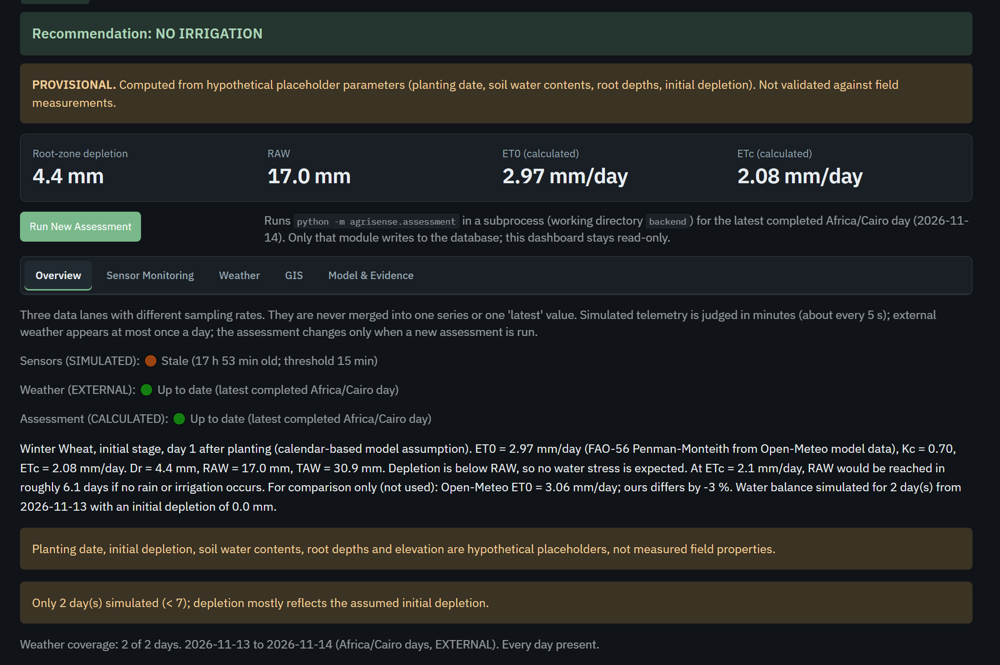
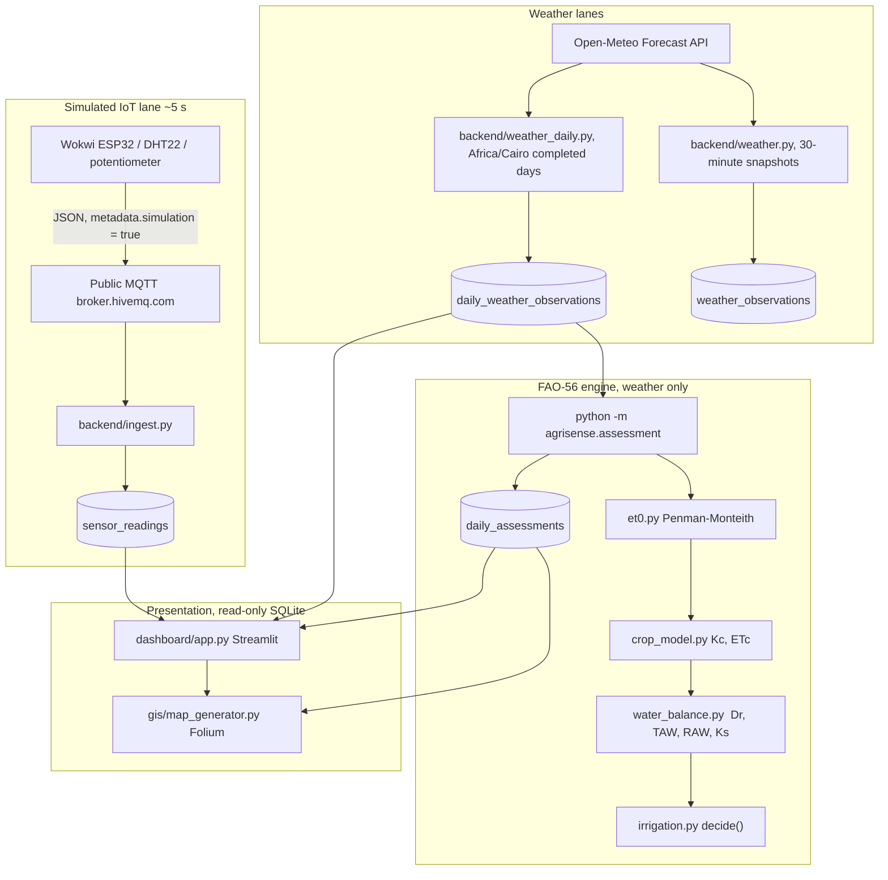
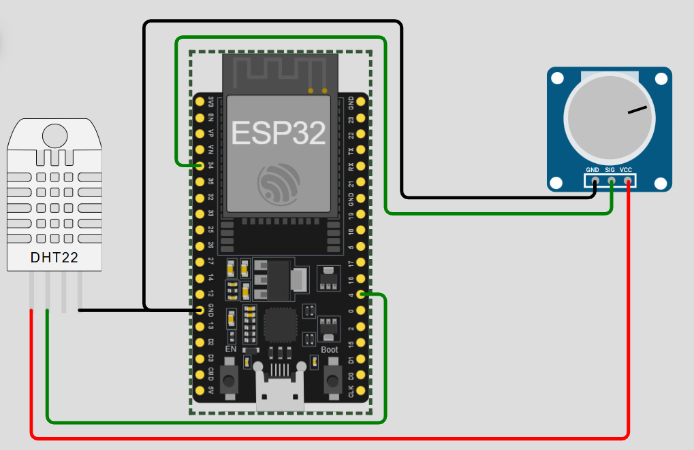
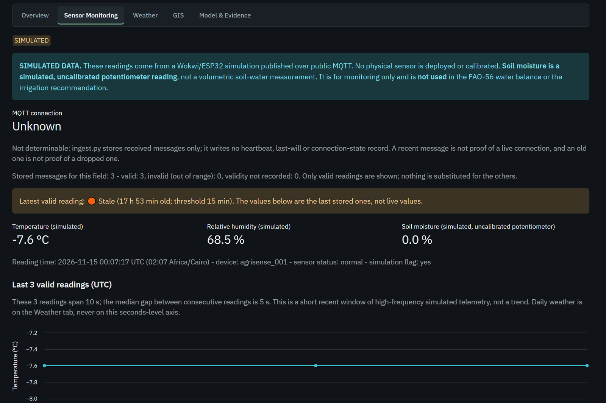
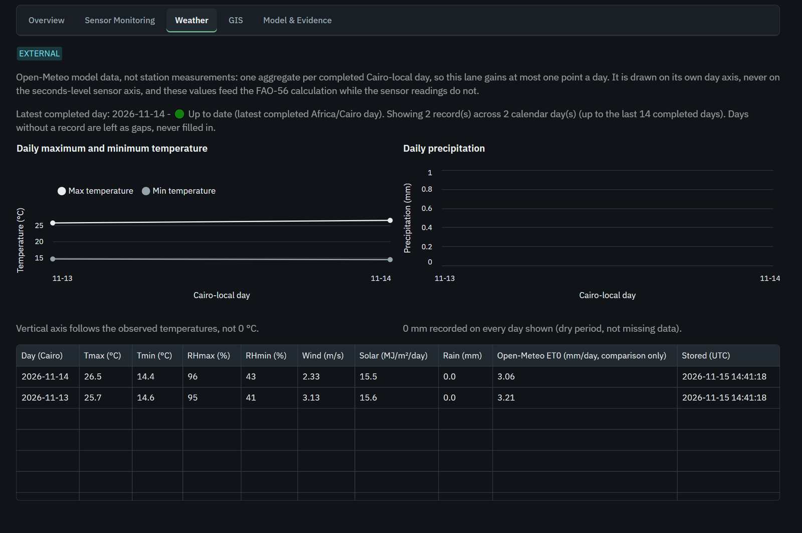
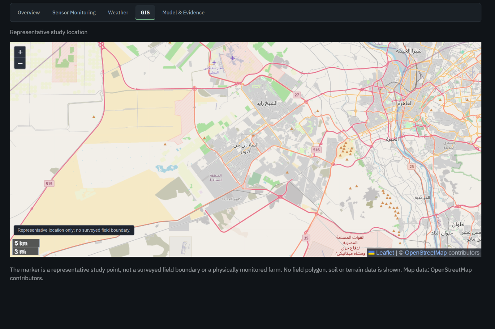
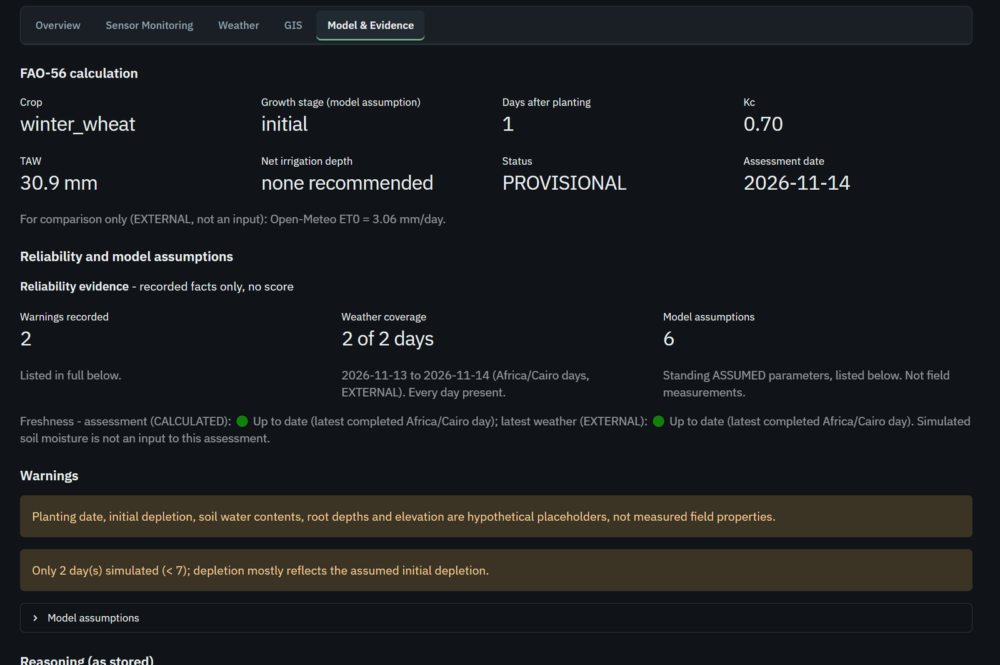
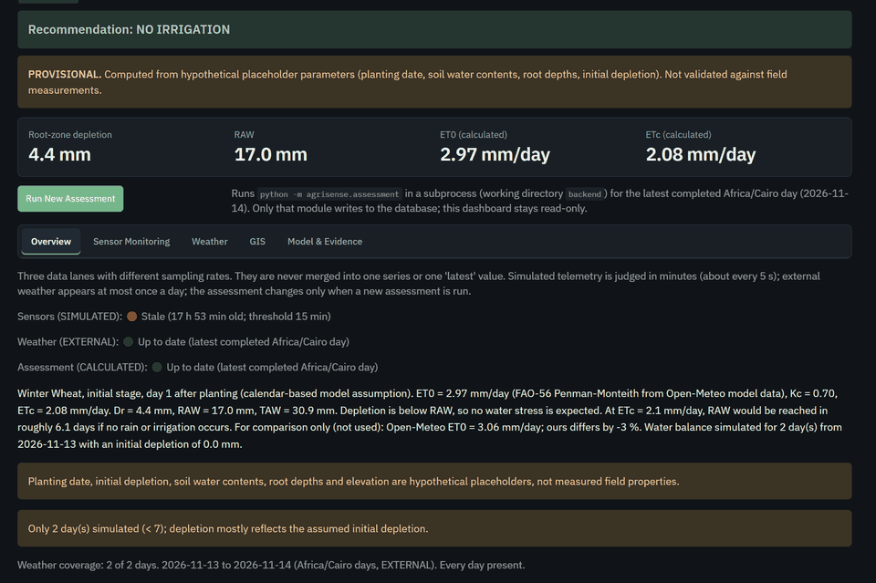

# AgriSense

**An IoT-Driven, GIS-Integrated Agricultural Decision-Support System for Predictive Irrigation Planning**

Research prototype for winter wheat at a representative study point near 6th of October City, Egypt. AgriSense collects a simulated ESP32 sensor stream and daily Open-Meteo weather, computes FAO-56 reference and crop evapotranspiration, maintains a root-zone water balance, and presents a transparent irrigation recommendation. It does not control a pump, apply water, or represent a surveyed farm.

[](https://www.python.org/)
[](https://streamlit.io/)
[](https://www.sqlite.org/)
[](https://www.hivemq.com/mqtt/public-mqtt-broker/)
[](https://www.fao.org/4/X0490E/x0490e00.htm)



*Persistent agricultural assessment (recommendation, water-balance metrics, Run New Assessment) with five native Streamlit tabs beneath it. Values are from the local research database, not a production farm.*

---

## Overview

Irrigation scheduling usually splits environmental observations, daily weather, and a root-zone water-balance model across separate tools. AgriSense keeps those lanes separate, timestamps them, and only then produces a recommendation.

1. A Wokwi-simulated ESP32 publishes JSON telemetry (DHT22 temperature/humidity and an uncalibrated potentiometer as “soil moisture”) to a public MQTT broker about every five seconds.
2. `backend/ingest.py` validates and stores those messages in SQLite.
3. `backend/weather_daily.py` fetches completed Africa/Cairo days from the Open-Meteo Forecast API into the same database.
4. `python -m agrisense.assessment` computes FAO-56 Penman–Monteith ET₀, winter-wheat ETc, a simplified root-zone depletion, and `IRRIGATE`, `MONITOR`, or `NO_IRRIGATION`.
5. A Streamlit dashboard and a Folium map present the result with provenance labels (`SIMULATED`, `EXTERNAL`, `CALCULATED`, `ASSUMED`) and recorded warnings.

The interesting parts are the **two independent cadences** (seconds-level simulated IoT vs daily weather), the **refusal to invent missing weather**, the **explicit FAO-56 implementation**, and a **read-only dashboard** that can only trigger assessment by subprocess. Simulated soil moisture is shown for monitoring and is **not** an input to ET₀, ETc, depletion, or the irrigation rule.

---

## Key capabilities

Verified in this repository:

| Capability | What is implemented |
|---|---|
| Simulated IoT node | Wokwi ESP32-DevKit-C, DHT22 on GPIO 4, potentiometer on GPIO 34 (`firmware/wokwi/`) |
| MQTT ingest | HiveMQ public broker, topic `agrisense/demo/field_001/sensors`, range checks, duplicate suppression |
| SQLite persistence | `sensor_readings`, `weather_observations`, `daily_weather_observations`, `daily_assessments` |
| Daily weather | Open-Meteo Forecast API, Africa/Cairo day definition, completed days only |
| Current weather snapshots | Optional `weather.py` loop every 30 minutes; **not** used by FAO-56 |
| FAO-56 ET₀ | Daily Penman–Monteith (Eq. 6), G = 0, wind height conversion (Eq. 47) |
| Crop ET | Single-coefficient winter wheat, ETc = Kc × ET₀ |
| Root-zone balance | TAW, RAW, Ks, depletion update; rainfall treated as fully effective |
| Irrigation advice | `IRRIGATE` / `MONITOR` / `NO_IRRIGATION`; net depth = Dr when irrigating |
| Assessment status | `OK`, `PROVISIONAL`, `INSUFFICIENT_DATA` (the last is never stored) |
| GIS | One Folium marker at the configured coordinates; OSM tiles; popup closed on load |
| Dashboard | Streamlit 1.67, five tabs, dark theme, read-only SQLite, subprocess assessment |
| Validation | Payload structure, numeric plausibility ranges, unit checks on the weather API |

Not implemented: physical sensors, a Python MQTT publisher fallback, pump or valve control, field polygons, soil maps, multi-field operations, or calibration against measured soil water.

---

## Technology stack

| Layer | Tools actually used |
|---|---|
| Embedded simulation | Wokwi, ESP32-DevKit-C v4, Arduino (`WiFi`, `PubSubClient`, `DHT`, `ArduinoJson`) |
| Messaging | MQTT 1883, public HiveMQ broker, Paho MQTT 2.1 |
| Backend | Python 3.10+, `requests`, standard library `sqlite3` / `argparse` / `unittest` |
| Database | SQLite file `backend/agrisense.db` (tables created on first run of each collector) |
| Agricultural modelling | FAO-56 (Allen et al., 1998), implemented in `backend/agrisense/` |
| Weather | Open-Meteo Forecast API (`timezone=Africa/Cairo` for daily rows) |
| GIS | Folium 0.20, OpenStreetMap raster tiles |
| Dashboard | Streamlit 1.67, Altair, pandas, streamlit-folium, IBM Plex via `.streamlit/config.toml` |
| Testing | `unittest` + Streamlit `AppTest` (dashboard); no pytest dependency |

---

## System architecture

Simulated telemetry and daily weather are stored side by side. Only the daily Open-Meteo series feeds the FAO-56 engine.



Payload formats, ingest rules, and the assessment CLI are in [Detailed architecture and data pipeline](#detailed-architecture-and-data-pipeline).

---

## Limitations and assumptions

- **Simulated IoT.** No physical ESP32, DHT22, or soil probe is deployed. Wokwi virtual Wi-Fi and HiveMQ’s public broker are used.
- **Uncalibrated “soil moisture”.** The potentiometer percentage is not volumetric water content and is excluded from the water balance (see `ASSUMPTION_NOTES` in `config.py`).
- **Representative location.** 29.97°N, 30.94°E is a study point near 6th of October City, not a surveyed field. Elevation 193 m is the Open-Meteo grid-cell value.
- **Placeholder soil and crop parameters.** Field capacity, wilting point, initial depletion, planting date, stage lengths, and initial root depth are hypothetical unless replaced. `parameters_are_assumptions = True` forces a `PROVISIONAL` status.
- **Model weather.** Open-Meteo values are model-derived, not station measurements. Completeness depends on the API and on running `weather_daily.py`.
- **Water-balance simplifications.** No runoff, interception, capillary rise, groundwater, or Kc climate adjustment. \(p\) is not adjusted for ETc. Newly explored soil is assumed at field capacity.
- **Public MQTT.** Topic and broker are unauthenticated. Treat the stream as a demo, not a private farm feed.
- **Not a controller.** No actuator, scheduling service, or production deployment is included. Decision support only.
- **Short record.** A water balance shorter than seven days records a warning that depletion still mostly reflects the assumed initial depletion.

---

## Future improvements

None of the following is in this tree:

- Replace the Wokwi node with a calibrated field sensor and a private broker.
- Survey soil water contents, rooting depth, and planting date; set `parameters_are_assumptions = False` only after that.
- Compare modelled \(D_r\) with independent soil-water or lysimeter measurements.
- Evaluate additional crops or fields without merging their time series.
- Consider a station or reanalysis product where Open-Meteo grid bias matters.
- Add ingest/firmware tests and a documented Python publisher for offline demos.

---

<details>
<summary><strong>Detailed architecture and data pipeline</strong></summary>

## Detailed architecture and data pipeline

`weather.py` writes `weather_observations` for monitoring. The assessment module never creates or reads that table. Open-Meteo’s own `et0_fao_evapotranspiration` is stored as `openmeteo_et0_mm` for comparison and is never an input to `calculate_et0()`.

### Simulated sensor payload

Published about every 5 s from `firmware/wokwi/sketch.ino`:

```json
{
  "device_id": "agrisense_001",
  "field_id": "field_001",
  "timestamp": "2026-11-15T00:07:17Z",
  "readings": {
    "temperature_c": -7.6,
    "humidity_pct": 68.5,
    "soil_moisture_pct": 0.0
  },
  "metadata": {
    "simulation": true,
    "sensor_status": "normal"
  }
}
```

`ingest.py` rejects malformed UTF-8/JSON/structure. Out-of-range but well-formed readings are stored with `is_valid = 0` (temperature −40…80 °C, humidity and soil 0…100 %). Duplicates on `(device_id, field_id, timestamp)` are ignored. There is **no** Python publisher fallback; the Wokwi sketch is the publisher.

Wokwi layout (`firmware/wokwi/`): DHT22 data → GPIO 4; potentiometer SIG → GPIO 34 (12-bit ADC mapped 0–100 %). `metadata.simulation` is always `true` in the published JSON.



### Daily weather

`weather_daily.py` requests `past_days=2` and `forecast_days=1` with `timezone=Africa/Cairo`, then keeps only dates **strictly before** the current Cairo calendar day. Rows are tagged `api_source = open-meteo;tz=Africa/Cairo`. Legacy rows tagged exactly `open-meteo` (UTC-day aggregates from an earlier script version) remain in the file but are not used by the assessment.

Stored daily fields include Tmax/Tmin, RHmax/RHmin/RHmean, mean surface pressure, 10 m wind, shortwave sum (MJ m⁻²), precipitation, and Open-Meteo ET₀ for comparison.

### Assessment generation

From `backend/`:

```text
python -m agrisense.assessment
python -m agrisense.assessment --date 2026-11-14
python -m agrisense.assessment --irrigation 2026-11-14=20
```

The engine walks every local day from `simulation_start_date` through the assessment date. A single missing or invalid weather day yields `INSUFFICIENT_DATA`. Historical weather is never interpolated.

The dashboard **Run New Assessment** button runs that same module as a subprocess with working directory `backend/` and `--db` pointing at `backend/agrisense.db`. The Streamlit process itself opens the database read-only (`mode=ro`) and never executes SQL writes.

A stored assessment row is unique on `(field_id, assessment_date, crop_id, config_hash)`. Re-running identical settings is a duplicate, not an overwrite.

</details>

<details>
<summary><strong>Scientific methodology and equations</strong></summary>

## Scientific methodology and equations

The physics layer is a transparent, rule-based implementation of FAO Irrigation and Drainage Paper 56 (Allen, Pereira, Raes and Smith, 1998). Intermediate terms are retained on `ET0Result` and `DayState` so tests can check more than the final millimetres.

### 1. Reference evapotranspiration (ET₀)

Daily grass-reference Penman–Monteith (FAO-56 Eq. 6), with soil heat flux **G = 0** at a daily step (Eq. 42):

$$
ET_0 = \frac{0.408\,\Delta(R_n - G) + \gamma\dfrac{900}{T+273}\,u_2(e_s-e_a)}{\Delta + \gamma(1 + 0.34\,u_2)}
$$

- \(T\) is mean daily air temperature (°C); \(u_2\) is wind speed at 2 m, converted from the 10 m Open-Meteo series with Eq. 47.
- \(e_s\) uses Eq. 12 (mean of \(e^0(T_{\max})\) and \(e^0(T_{\min})\)); \(e_a\) uses Eq. 17 with \(RH_{\max}\) and \(RH_{\min}\).
- Net radiation follows Eqs. 21–25, 37–39. Solar radiation must be the daily sum in MJ m⁻² day⁻¹, not W m⁻².
- A negative result is clipped to 0 and flagged. Missing, non-finite, or implausible inputs raise; nothing is substituted.

### 2. Crop coefficient (Kc)

Winter wheat, single crop coefficient (FAO-56 Tables 11, 12 and 22; Fig. 34 / Eq. 66):

| Stage | Length (days) | Kc |
|---|---|---|
| Initial | 30 | 0.70 |
| Development | 140 | linear 0.70 → 1.15 |
| Mid-season | 40 | 1.15 |
| Late-season | 30 | linear 1.15 → 0.25 |

Stage is a **calendar-day model assumption** from a configurable planting date (default 13 November 2026), not an observation of crop development. The Kc mid/end climate adjustment (Eqs. 62, 65) is not applied.

### 3. Crop evapotranspiration

$$
ET_c = K_c \times ET_0
$$

(FAO-56 Eq. 58.) Under water stress the balance uses \(ET_{c,adj} = K_s\,ET_c\) (Eq. 81).

### 4. Root-zone water balance

$$
TAW = 1000\,(\theta_{FC} - \theta_{WP})\,Z_r \qquad (Eq.\ 82)
$$

$$
RAW = p \cdot TAW \qquad (Eq.\ 83)
$$

$$
K_s =
\begin{cases}
1 & D_r \le RAW \\
\dfrac{TAW - D_r}{(1-p)\,TAW} & D_r > RAW
\end{cases}
\qquad (Eq.\ 84)
$$

$$
D_{r,i} = D_{r,i-1} - P - I + ET_{c,adj}
\qquad \text{(Eq. 85, simplified)}
$$

\(D_r\) is floored at 0 (excess treated as deep percolation) and capped at TAW. Default placeholders: \(\theta_{FC}=0.23\), \(\theta_{WP}=0.11\) m³ m⁻³ (FAO-56 Table 19 sandy-loam mid-points), \(p=0.55\), initial \(D_r=0\) mm, \(Z_r\) growing from 0.25 m to 1.5 m. Rainfall is 100 % effective (no runoff, interception, or capillary rise).

### 5. Irrigation decision

From `backend/agrisense/irrigation.py`, applied to the **end-of-day** state:

| Recommendation | Condition | Net depth |
|---|---|---|
| `IRRIGATE` | \(D_r \ge RAW\) | \(D_r\) mm (refill to field capacity) |
| `MONITOR` | \(D_r + ET_c \ge RAW\) | none |
| `NO_IRRIGATION` | otherwise | none |
| `INSUFFICIENT_DATA` | incomplete weather, out of season, or invalid inputs | none; **not stored** |

The depth is a net depth. Application efficiency, leaching requirement, and system losses are not included. Nothing in this project actuates irrigation.

### 6. Assessment status

| Status | Meaning |
|---|---|
| `OK` | A complete water-balance run with no recorded warnings |
| `PROVISIONAL` | A complete run that recorded assumption or short-record warnings (the usual state while placeholders remain) |
| `INSUFFICIENT_DATA` | No defensible recommendation; printed, never inserted |

</details>

<details>
<summary><strong>Dashboard screenshots and demonstration</strong></summary>

## Dashboard screenshots and demonstration

The header, recommendation, Dr / RAW / ET₀ / ETc, and the assessment button stay visible above five native tabs. Start the app from the project root (see [Installation and setup](#installation-and-setup)).

| Tab | Contents |
|---|---|
| Overview | Lane cadence, freshness recap, stored reasoning, warnings |
| Sensor Monitoring | Simulated telemetry, MQTT “Unknown” connection (no heartbeat is stored), charts and valid-reading table |
| Weather | Cairo-local daily Tmax/Tmin and precipitation; dry days are 0 mm, not gaps |
| GIS | Representative-location OSM map, 580 px, popup closed |
| Model & Evidence | FAO-56 parameters, reliability facts, assumption list, last subprocess run |











The map can also be written to `gis/field_map.html`:

```text
python gis/map_generator.py
```

The marker is a representative point (29.97°N, 30.94°E). No field boundary, soil layer, or sensor coverage is shown.

</details>

<details>
<summary><strong>Installation and setup</strong></summary>

## Installation and setup

### Prerequisites

- Python 3.10 or later (this tree was last executed with 3.14.7).
- Internet access for Open-Meteo, MQTT (`broker.hivemq.com:1883`), OSM map tiles, and (on Windows) the `tzdata` package already listed in `backend/requirements.txt`.
- Optional: [Wokwi](https://wokwi.com) to run the ESP32 simulation.

No project-specific environment variables are read. Broker host, topic, coordinates, and database path are constants in the Python modules.

### Virtual environment and dependencies

From the project root:

```bash
python -m venv .venv
```

Windows:

```powershell
.\.venv\Scripts\Activate.ps1
pip install -r backend\requirements.txt
```

macOS / Linux:

```bash
source .venv/bin/activate
pip install -r backend/requirements.txt
```

`pandas` and `altair` arrive with Streamlit. There is no separate frontend build.

### Database

There is no standalone migration command. Each writer creates only its own table with `CREATE TABLE IF NOT EXISTS` on first run:

| Script | Table |
|---|---|
| `ingest.py` | `sensor_readings` |
| `weather.py` | `weather_observations` |
| `weather_daily.py` | `daily_weather_observations` |
| `python -m agrisense.assessment` | `daily_assessments` |

### Collect data

In separate terminals, from `backend/`:

```bash
python ingest.py
python weather_daily.py
```

`ingest.py` needs a publisher on `agrisense/demo/field_001/sensors`. Open `firmware/wokwi/sketch.ino` with `diagram.json` in Wokwi (virtual Wi-Fi `Wokwi-GUEST`, empty password). The node uses NTP (`pool.ntp.org`) for ISO-8601 UTC timestamps.

Optional current-weather snapshots (not required for an assessment):

```bash
python weather.py
```

`weather_daily.py` accepts `--field-id`, `--latitude`, and `--longitude`; defaults come from `agrisense.config.DEFAULT_CONFIG` (field `field_001`, 29.97°N, 30.94°E). It repeats every 24 hours until interrupted.

### Run an assessment

From `backend/`:

```bash
python -m agrisense.assessment
```

Default date is yesterday in `Africa/Cairo`. `--db` defaults to `backend/agrisense.db`.

### Dashboard

From the **project root** so `.streamlit/config.toml` is picked up:

```bash
streamlit run dashboard/app.py
```

The UI opens on http://localhost:8501. Use **Reload data** in the sidebar after collectors or an assessment have written new rows. **Run New Assessment** is the only write path, and it is a subprocess of `agrisense.assessment`, not a SQL statement from Streamlit.

</details>

<details>
<summary><strong>Testing and evaluation</strong></summary>

## Testing and evaluation

Standard-library `unittest` only. Temporary databases are used; hashes in the dashboard and GIS suites check that `backend/agrisense.db` is not written.

From the project root:

```bash
python -m unittest discover -s dashboard -q
python -m unittest discover -s gis -q
```

From `backend/`:

```bash
python -m unittest discover -s tests -q
```

Results on this machine (15 November 2026):

| Suite | Command working directory | Result |
|---|---|---|
| Backend | `backend/` | **187 tests, OK** (1.4 s) |
| GIS | project root | **55 tests, OK** (5.8 s) |
| Dashboard | project root | **113 tests, OK** (43 s) |

These tests check software behaviour (equations against FAO-56 worked examples, validation, UI structure). They do **not** establish that the recommendation is agronomically valid in the field.

There are currently no automated tests for `ingest.py`, `weather.py`, or the Arduino sketch.

</details>

<details>
<summary><strong>Repository structure</strong></summary>

## Repository structure

```text
AgriSense/
├── backend/
│   ├── agrisense/              FAO-56 package (import as agrisense.*)
│   │   ├── assessment.py       daily assessment CLI and persistence
│   │   ├── config.py           study / crop / soil placeholders
│   │   ├── crop_model.py       Kc curve and ETc
│   │   ├── et0.py              Penman-Monteith ET0
│   │   ├── irrigation.py       IRRIGATE / MONITOR / NO_IRRIGATION
│   │   ├── validation.py       numeric guards and errors
│   │   └── water_balance.py    TAW, RAW, Ks, depletion
│   ├── tests/                  physics and weather_daily unit tests
│   ├── ingest.py               MQTT subscriber -> sensor_readings
│   ├── weather_daily.py        Open-Meteo daily -> FAO-56 inputs
│   ├── weather.py              Open-Meteo current snapshots (not modelled)
│   ├── requirements.txt        Python dependencies
│   └── agrisense.db            shared SQLite file used at runtime
├── dashboard/
│   ├── app.py                  Streamlit UI (read-only)
│   └── test_app.py
├── gis/
│   ├── map_generator.py        Folium map builder
│   └── test_map_generator.py
├── firmware/wokwi/
│   ├── sketch.ino              ESP32 MQTT publisher
│   ├── diagram.json            Wokwi parts and wiring
│   └── Connections.PNG         wiring screenshot
├── .streamlit/config.toml      dark dashboard theme
├── docs/assets/                README screenshots and GIF
└── README.md
```

`data/agrisense.db` may exist as a leftover file. The dashboard, GIS module, and collectors all use **`backend/agrisense.db`**.

</details>

<details>
<summary><strong>References</strong></summary>

## References

1. Allen, R.G., Pereira, L.S., Raes, D. and Smith, M. (1998). *Crop evapotranspiration — Guidelines for computing crop water requirements.* FAO Irrigation and Drainage Paper 56. Rome: FAO. https://www.fao.org/4/X0490E/x0490e00.htm  
   Worked examples used in `backend/tests/test_et0.py`: Chapter 3 (https://www.fao.org/4/X0490E/x0490e07.htm), Chapter 4 Example 18 (https://www.fao.org/4/X0490E/x0490e08.htm).
2. Open-Meteo Forecast API documentation. https://open-meteo.com/en/docs
3. HiveMQ public MQTT broker. https://www.hivemq.com/mqtt/public-mqtt-broker/
4. Wokwi ESP32 simulator. https://wokwi.com
5. Streamlit documentation. https://docs.streamlit.io
6. Folium. https://python-visualization.github.io/folium/
7. OpenStreetMap tile usage and copyright. https://www.openstreetmap.org/copyright

</details>
